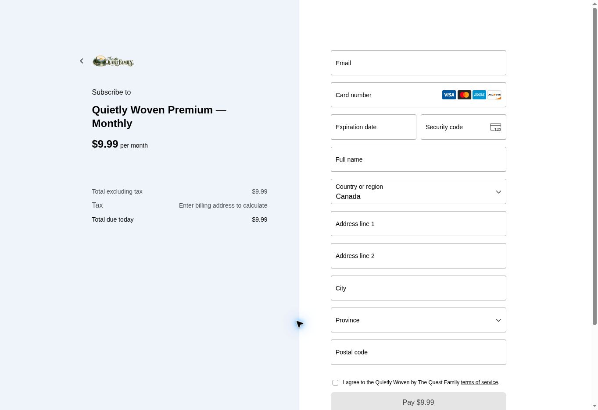

# Quietly Woven paid checkout — November 7, 2026

The owner requested work on paid checkout and identified `support.questfamily@gmail.com` as the hosting account. The existing application has now been deployed with its live RevenueCat Billing configuration. The live monthly payment form opens; no real payment has been submitted, and successful live purchase/receipt acceptance remains outstanding.

## Account and project continuity

- The correct Netlify login is `support.questfamily@gmail.com`; select **TheQuestFamily**, the existing Pro team at `https://app.netlify.com/teams/questfamilylearning/projects`.
- That login also has an empty Free team called QuestFamily's team. The separate `focusquest888@gmail.com` login reaches a different empty team. Do not create replacement projects or infer that the live projects are missing from those empty views.
- Existing project: `quietly-woven`, linked to `FocusQuestLearning/Mindful-Journal`. The website remains the separate `thequestfamilyca` project linked to `FocusQuestLearning/questfamily-website`.

## Checkout blocker and saved correction

Production had the isolated, working email sign-in configuration but neither required billing variable. Added only the existing RevenueCat **public client** key and explicit live mode, scoped to **Builds / Production**:

| Variable | Saved configuration |
| --- | --- |
| `EXPO_PUBLIC_REVENUECAT_WEB_API_KEY` | Existing live `rcb_` public SDK key from Quietly Woven Web, app `app6173dcd352`; value omitted from this record |
| `EXPO_PUBLIC_WEB_BILLING_MODE` | `live` |

Other deploy contexts remain empty in these two dashboard variables; isolated previews retain their source-controlled sandbox configuration. The existing production sign-in URL, exact allowed origin and isolated Neon branch were verified and retained. No SMTP password, database credential, server key, tax identifier or payment credential was copied or changed.

RevenueCat's saved configuration still uses gateway **The Quest Family**, `acct_1TBK8G2I73ZcCQNK`, CAD default currency, required terms consent, annual renewal emails, automatic Stripe Tax and `txcd_10000000`. Its default offering maps the web monthly and annual packages to the approved CAD9.99 and CAD79.99 products. Old products and native mappings were retained. The prior saved Canadian GST/HST registration and sandbox tax evidence remain recorded in the app's November 6 provider report; no registration or tax plan was changed here.

## Deployment and direct observations

- Rebuilt without cache to incorporate the new public build configuration.
- Netlify production deploy **`6aef5ee35c15c94aa784654c`**, source **`a9fa0b3`**, visibly reached **Published deploy for quietly-woven**. This redeploy changes configuration, not app source or a native binary.
- The owner completed the actual production email-code sign-in. Reload retained the verified support-account session. The unpaid account's Calendar stayed locked before and after live billing activation.
- Production paywall now retrieves **CA$9.99/month** and **CA$79.99/year** from the provider; Continue and browser-purchase recovery are enabled for the verified account.
- Selected Monthly and opened the actual payment form. The provider's read-only order summary reports **`livemode: true`**, **`currency: cad`**, **`totalAmount: 999`** and recurring/future charges. This is the base amount before the missing billing address is supplied.
- The form displays Quietly Woven Premium — Monthly, the business artwork/name, required terms consent and **Enter billing address to calculate** tax. Country was set to Canada; all email, name, address and card fields remain empty, terms remain unchecked and Pay remains disabled.
- No real card, payment, refund or subscription was submitted. Opening a live form is not evidence of settlement, a delivered live receipt or Premium unlock after payment.

## Website alignment and validation

The product page's pricing card, FAQ and availability paragraph are updated to describe verified-email browser Premium access. They retain CAD9.99/month, CAD79.99/year, annual billing, applicable-tax disclosures, the free journal and all existing Premium boundaries. Mobile download links remain unavailable; no cross-device writing backup or web-to-native restoration claim is added.

Production website build, Next.js type validation and static export pass. Both exported product routes retain one H1, both browser-journal buttons, current free/Premium counts, legal/support links and two visible applicable-tax notices. Their old browser-purchases-unavailable and price-preview copy is removed. This is a text correction, with no new dependencies or app code.

## Remaining acceptance

1. An owner-completed live purchase with the final actual address/tax total and recurring plan reviewed before payment; then verify receipt delivery, entitlement unlock, reload and purchase recovery. A real charge needs the owner's explicit spending choice and payment action.
2. Actual mobile-browser sign-in/session/checkout acceptance and the second production account's isolation checks. Desktop responsive rendering is not a real-device pass.
3. Preserve the existing accepted monthly/annual sandbox payments, receipts, decline/terms, renewal/cancellation/expiry, taxed refund/reversal and saved-writing evidence. Do not repeat purchases merely to resume this work.
4. Native purchase/restore/security/accessibility acceptance, Apple subscription review images and full quotation provenance/publication-rights review remain separate open work.

The live checkout connection is configured and the pre-payment screen is verified. A completed live payment and a full launch acceptance claim are not established by this continuation.
