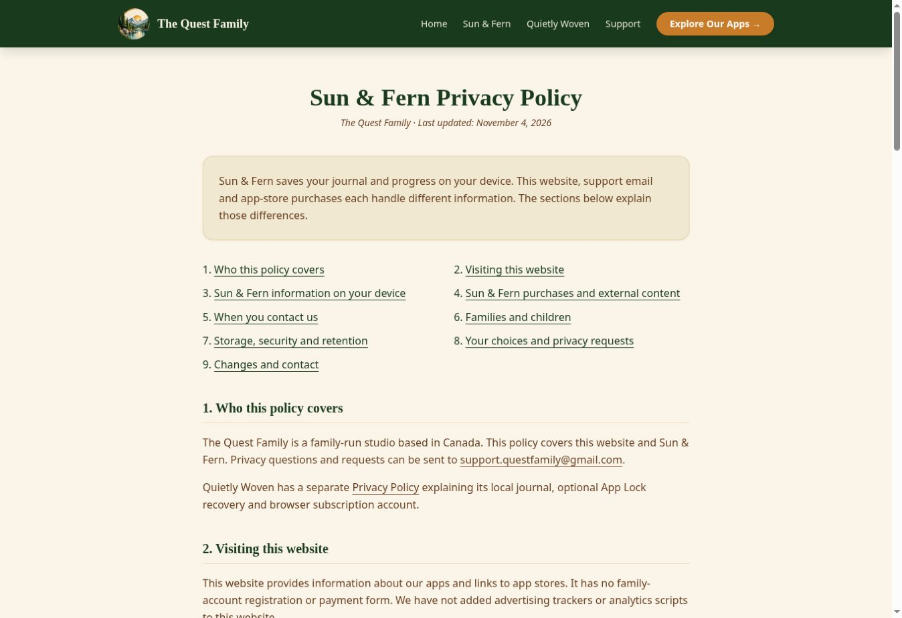

# Publication complete — 4 November 2026 (Toronto)

The owner approved merging PR7, production publication and owner-account sign-in if needed. [PR7](https://github.com/FocusQuestLearning/questfamily-website/pull/7) is merged at `f9cfbf69e6bc3c967ca328c520012a2ce2d68b47`, whose tree exactly matches the reviewed source `b97ee7d497358bbd57cba950a4ceddace6f78b72`.

The existing TheQuestFamily Netlify project **thequestfamilyca** shows this source as **Published**, deployed in 27 seconds at 12:22 PM. [Deploy details](https://app.netlify.com/projects/thequestfamilyca/deploys/6aeb69d37b0f598f2a7e0be5). Publication followed the authorized merge automatically; no replacement project, manual duplicate deploy or mobile build was created.

Live verification passed on the homepage, Privacy, Support, Terms, product, download and both old URLs: all final responses were HTTP200, current Sun & Fern branding was present, no former name appeared in visible text/alt labels, and the canonical routes matched. All four old-route variants returned actual HTTP301 responses to the new branded paths. The live privacy page was also inspected in the browser.

This closes the website publication/branding gate. App Store privacy-label reconciliation and native/store/artwork acceptance remain separate; this does not claim full release acceptance. The preparation-only publishing holds below are historical and superseded by this owner-approved, verified publication.

---

# Sun & Fern privacy and website branding — 4 November 2026 (Toronto)

## Requested result

The owner requested correction of the privacy page and remaining public SummerQuest branding. Continue the existing website and existing Netlify project; this is not a new site or another mobile build.

Base: website main `c6aa506722e00f6bbf15dc45062d5deab76b8ed0` (already-merged PR #4). The owner reports Build 22 is being tested separately. Do not duplicate that testing, create another native binary or claim its acceptance here.

## Completed source changes

- Privacy and Terms headings and browser titles identify **Sun & Fern** and use the actual update date, 4 November 2026. Shared legal-page dates for Quietly Woven are retained.
- Privacy explains local journal/progress and typed discovery locations, absence of GPS/camera/microphone/photo-library requests for these features, local membership-status caching, store purchases, external image network requests, support email and deletion. The policy does not claim that all information stays on-device or that nothing is collected by any provider.
- The one remaining public old-name sentence is removed from the product page. Homepage links, desktop/mobile navigation, footer and download links use `/sun-and-fern/` and `/get-sun-and-fern/`. Canonical metadata uses these routes on the existing `thequestfamily.ca` domain.
- Existing `/summerquest/` and `/get-summerquest/` routes still export the same current content with canonical new URLs. Four explicit Netlify 301 rules retain both slash and non-slash incoming links. The legacy privacy fragment is preserved as a hidden anchor; new section navigation uses `#sun-and-fern`.
- Existing Google Play package URL is preserved. Do not rename app/store identifiers, saved-state keys, badge IDs, Expo project or repository. Unused historical artwork/evidence is preserved; approved website art and the parent brand remain unchanged.
- Product membership copy no longer implies that the overall app offers only an annual plan. Existing platform-specific store availability is retained; this is not a Google Play release or name update.

## Evidence and verification

`npm run build` passed Next.js compilation, its existing type checks and static export. There are 15 exported HTML documents, including the two compatibility aliases and 404. The framework reports 16 generation units; this is not a count of public HTML files.

All 305 internal links/fragments and 63 image references resolve in the export. Visible text, headings, image alt text and accessible labels contain **zero old-brand occurrences** across all 15 HTML documents. Six canonical outputs and all four configured redirects match their intended destinations. Source diff whitespace check passed.

Browser QA used the built export through the managed preview. Privacy, Terms, Support, product and download pages were inspected in 320px and 390px iframe widths (actual content viewports 305px and 375px with scrollbars). No horizontal overflow or visible old brand was found. Mobile navigation opens by keyboard and reaches the new product page; the membership-cancellation FAQ opens by keyboard. This is website QA, not native iOS acceptance.

Full measured results: [validation JSON](sun-and-fern-privacy-branding-2026-11-04.json).

Before changes, direct production reads returned HTTP200 with raw SummerQuest counts: Privacy40, Support30, Terms26, product19, download43; zero Sun & Fern matches. The public deployment is older than the approved rebrand. This source update is **not yet published**.

## Privacy evidence boundaries

The reviewed Build22 binary is from `adf80ed6de4c76b7903e6144b331809597b94a44`. Its previously verified IPA SHA256 is `74706aeba7885c683f13fdc0b4656630c348edc9371743b6ed797f705e583e8e`. The actual Hermes string-table check in this task found only three compatibility values containing the old name: `@summerquest_v1`, `@summerquest_subscription_v1` and `summerquest-hero`. The existing badge-art review also records zero active old-brand artworks/tokens; it was reused, not repeated or replaced.

Reviewed source: AppContext, SubscriptionContext, subscription constants/purchase helper, Settings, NaturePhoto, imageHeaders and app.json. The candidate package evidence confirms absent sensitive iOS usage-description keys. Empty privacy-manifest collection arrays are not a full native network audit. No private journal/account data was used for this review.

[Apple's privacy-label guidance](https://developer.apple.com/app-store/app-privacy-details/) distinguishes on-device processing, off-device retention and third-party practices. The existing App Store label (previously observed Email Address/User ID/Purchase History) still needs reconciliation against actual native/provider flows; no new label answer or “Data Not Collected” claim was published. Support email is separate from an in-app family login. Actual third-party network retention is not established by this website edit.

## Publishing continuation

Use existing Netlify team **TheQuestFamily**, team URL `https://app.netlify.com/teams/questfamilylearning/projects`, existing project **thequestfamilyca**, custom domain **thequestfamily.ca**. Never create a replacement account/team/site. Existing app web project `summerquest` is a separate project; do not publish this website there.

The owner's previous workflow requires separate production deployment approval. Save this concrete reviewed source before asking to merge/publish. If sign-in is necessary, explicit owner-account sign-in authorization is also needed because the earlier secure sign-in attempt was rejected by automatic approval review. No sign-in chooser was retried here.

After authorized merge/publication, verify Privacy, Support, Terms, homepage, both new routes and both legacy redirects on the live domain. Keep the already-built iOS22 candidate and separate native testing. This task does not authorize App Store privacy mutations, screenshots, submission, an Android build or app-web deployment.
